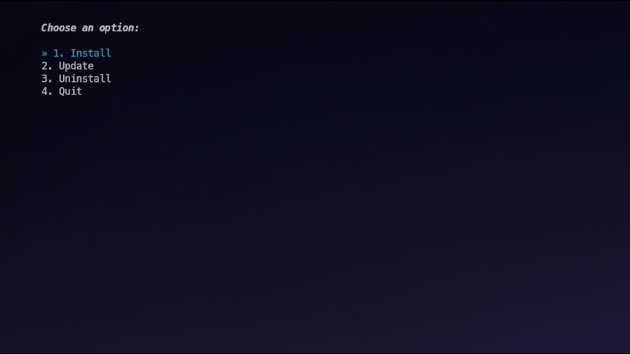

<h1 align="center">
    NextCloud Talk Manager
     
    
     
    

      

      

         
         

         
      

       
   

</h1>

## Preview

---

## How does it work?

The tool will fetch the latest release-tag from the GitHub pages, and downloads the flatpak file. After that, it will install the flatpak file with `flatpak install` - almost the same with the Update functionality.

## Requirements

- Flatpak
- Java

## Installation

1. Download the latest Release from this repository.
2. Execute the file with a double-click or `java -jar file-name.jar`
3. Proceed with your own steps.

## License
 
[MIT](../LICENSE)